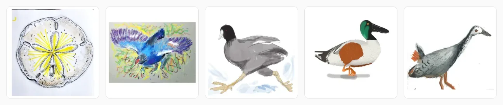

# Wildlife Illustrated

> _The drawings carry the colour. Everything around them makes room._

A gallery of hand-drawn wildlife, one species at a time: birds, sharks and shells, each shown with
its English and scientific names, and its Dhivehi name where it has one. Every species has its place
from the start, drawn or not, so the gaps are part of the record.

[](https://seven-leven.github.io/bird_dash/)

**[View the live site →](https://seven-leven.github.io/bird_dash/)** ·
**[About the archive →](https://seven-leven.github.io/bird_dash/#about)** ·
[The docs →](https://seven-leven.github.io/bird_dash/docs/) ·
[How the site was built →](https://seven-leven.github.io/folio/code-wildlife.html)

## Features

- **Collections** — birds, sharks and shells, each with its own groups, icon, accent colour and
  reference links. Content is data: a new drawing or a whole new collection is JSON and images, no
  code.
- **Two views** — by family, order or group, or by the month each piece was drawn.
- **Search everything** — common, scientific and Dhivehi names across every collection, from the
  keyboard (`Ctrl`/`⌘ K`, `↑`/`↓`/`↵`).
- **Honest progress** — an undrawn species shows its collection's silhouette, and every count says
  how many are drawn of how many.
- **The viewer** — full resolution with zoom and pan, the names in three languages, the
  illustrator's note, and where to learn more.
- **An About page** — progress per collection and the newest drawings, every number worked out by
  the build.
- **Dhivehi throughout** — Thaana set in Faruma; dark mode; phone to desktop.

Built with Vue 3, Vite and Tailwind CSS 4 on Node 24, with sharp for the images.

## Quick start

```bash
git clone https://github.com/seven-leven/bird_dash.git
cd bird_dash
npm install
npm run dev
```

Open [http://localhost:5173](http://localhost:5173).

| Command         | What it does                                                     |
| --------------- | ---------------------------------------------------------------- |
| `npm run dev`   | Start the dev server                                             |
| `npm run build` | Turn new drawings into WebP images, then build the site          |
| `npm test`      | Every test tier, one row each (`npm test -- src/lib` for a part) |
| `npm run check` | Find missing or orphaned images and stale numbers; exits 1       |

Every other command is in [WORKFLOW.md](docs/WORKFLOW.md#commands). To add a drawing or a
collection, see the recipes in [DATA.md](docs/DATA.md#recipes).

## Documentation

The pages below are also a site, in the gallery's own design:
**[seven-leven.github.io/bird_dash/docs](https://seven-leven.github.io/bird_dash/docs/)**, built
from these files on every deploy (`npm run docs:dev` serves it locally).

| Page                                          | Read it when                                                             |
| --------------------------------------------- | ------------------------------------------------------------------------ |
| [GLOSSARY.md](docs/GLOSSARY.md)               | You need the word for something: one meaning each, and the ones to avoid |
| [ARCHITECTURE.md](docs/ARCHITECTURE.md)       | You want the big picture: the three programs, where things are, rules    |
| [DATA.md](docs/DATA.md)                       | You add a drawing or a collection, or change a field in `public/`        |
| [DESIGN.md](docs/DESIGN.md)                   | You add a button, a colour or an icon (the design manifesto)             |
| [TESTING.md](docs/TESTING.md)                 | You write a test or want to know what the tiers and areas mean           |
| [TEST-PROCEDURES.md](docs/TEST-PROCEDURES.md) | You set up a machine, a test or CI fails, or you maintain the runner     |
| [WORKFLOW.md](docs/WORKFLOW.md)               | You take a change to the live site; every command; the version           |
| [SCRIPTS.md](docs/SCRIPTS.md)                 | You write or change a script: the principles and the naming rules        |
| [DECISIONS.md](docs/DECISIONS.md)             | You wonder why something is done this way, before changing it            |
| [plans/TODO.md](docs/plans/TODO.md)           | You want to know what is next                                            |

## Versions and deploys

The footer reads like `v0.9.161 Valu Kukulhu · 18 drawings · 4f0f400`. Only `0.9` is stored; the
patch counts commits, each line is named after a drawing (the Dhivehi names in the order they were
drawn: v0.1 "Reyru", the first), the drawings are counted from the lists and the hash is the commit
built, so it cannot drift ([how](docs/WORKFLOW.md#versioning)).

Every pull request and every merge runs the same checks: lint, format, types, every test tier at
100% coverage (in four timezones, from UTC−8 to UTC+14), the asset check and the build. A merge to
`main` deploys to GitHub Pages only if they all pass ([how](docs/WORKFLOW.md#7-deploy)).

## License

[MIT](LICENSE)
