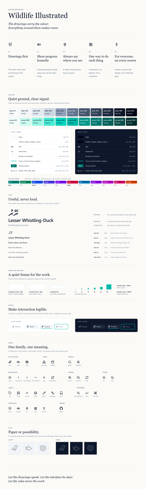
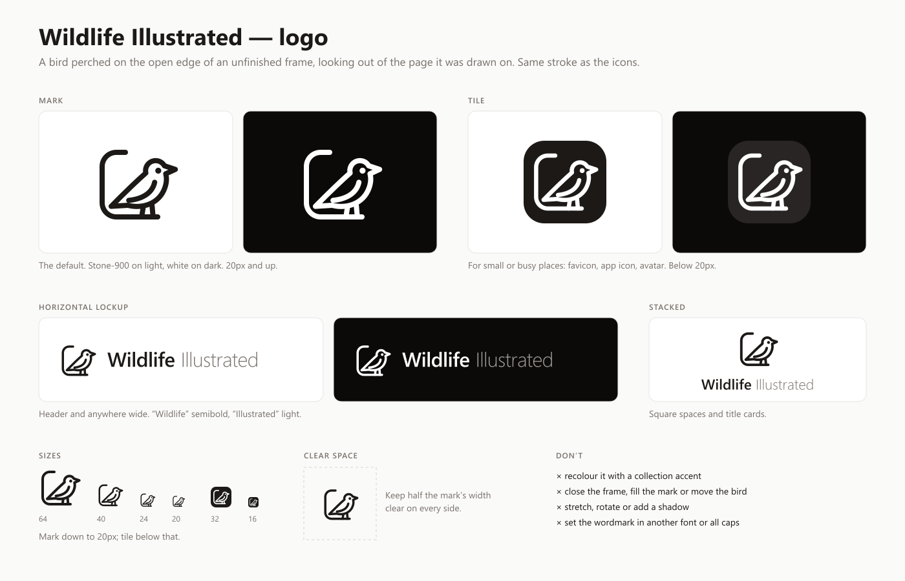

# Wildlife Illustrated

## A design manifesto

_The drawings carry the colour. Everything around them makes room._

Wildlife Illustrated is an archive of illustrations in progress. Its interface should feel like a
quiet field guide: clear, consistent and honest about what exists today and what is still to come.
This document is both its point of view and its practical reference.

The picture is drawn from the real tokens and icons by `npm run generate`. The source of truth for
the tokens is [`src/styles/`](../src/styles/main.css): `main.css` maps them into Tailwind,
[`tokens.css`](../src/styles/tokens.css) and [`accents.css`](../src/styles/accents.css) hold the
parts the docs site shares, and `components.css` the classes each role uses; this guide explains the
decisions behind them and how to apply them. The site's neutral is `stone`, a warm grey, so its
paper matches the guide's. The picture keeps a voice of its own (its own paper tone, a serif for
statements); neither is a site token. The site's colours are the swatches drawn on it.

---

## The five principles

### P1 — Drawings first

**The work is the most vivid thing on the screen.**

Illustrations carry the colour; the interface stays quiet. Nothing sits over a drawing except its
small id badge. Names, counts and controls belong beside or below it. When two choices work equally
well, choose the one that draws less attention to the interface.

### P2 — Show progress honestly

**A drawing and an empty space are not the same thing.**

This is a record of work in progress. Drawn work appears on paper-white; work not yet drawn recedes
into the interface's grey. Counts say exactly what is known, and never appear before the data is
ready.

### P3 — Always say where you are

**A visitor should never have to guess.**

The current collection, view, section and drawing are named and visibly marked. Headings stay with
the content they describe; current states use one consistent marker; links make it possible to
return. Navigation always explains both where someone is and how they got there.

### P4 — One way to do each thing

**Consistency is a feature, not a constraint.**

Tokens, components and language are shared across the site. Before creating a new pattern, use the
one that already exists. When a genuinely new pattern is needed, make it the shared pattern from
then on.

### P5 — For everyone, on every screen

**Access is part of the design, not a finishing pass.**

Start with phones. Support light and dark themes, keyboard and touch, readable contrast, reduced
motion, and both Thaana and English. Nothing essential depends on hover, colour alone or an
unlabelled icon.

When a decision is unclear, return to these principles. Change a rule if it conflicts with a
principle; do not quietly abandon the principle.

---

## 01. Colour — quiet ground, clear signal

_P1 Drawings first · P3 Always say where you are · P5 For everyone, on every screen_

Two ramps do the work: **stone** for neutral surfaces and text, **accent** for emphasis. Use token
names such as `stone-500` and `accent-700` in components, never raw hex values or a
collection-specific hue such as `teal-500`.

Every collection has one accent, declared as `accent` in `public/collections.json`. It helps
visitors know where they are: Birds use teal, Sharks blue, and Shells rose. The menu of allowed hues
lives in `src/styles/accents.css`, so a new collection can choose an approved hue without changing
the CSS.

### Where colour belongs

| Role                             | Light theme                  | Dark theme                   |
| -------------------------------- | ---------------------------- | ---------------------------- |
| Page                             | `stone-50`                   | `stone-950`                  |
| Surface: header, sidebar, menus  | white                        | `stone-950` / `stone-900`    |
| Strong text (`.text-strong`)     | `stone-900`                  | white                        |
| Body text (`.text-body`)         | `stone-600`                  | `stone-300`                  |
| Muted text (`.text-muted`)       | `stone-500`                  | `stone-400`                  |
| Borders and dividers             | `stone-200` / `stone-100`    | `stone-800`                  |
| Focus ring, current marker       | `accent-700`                 | `accent-500`                 |
| Progress                         | `accent-500`                 | `accent-500`                 |
| Primary button (`.btn-primary`)  | `accent-700` with white text | `accent-700` with white text |
| Drawing id badge (over an image) | white at 70% on black at 50% | the same                     |

The accent is a signal, not decoration. Reserve it for keyboard focus, the current item, progress,
search matches, the primary action, and links that move you within the site (in the viewer: the
group, "#11" in a note, "Read more"), in `accent-700` so they read as text. Links that leave the
site stay neutral, with `.link-out` (and `ExternalLink`, which opens them in a new tab). If the
accent appears in lots of places at once, it has stopped communicating.

Never make colour carry meaning alone. A current tab also has a fill and stronger text; colour
reinforces the state rather than being the only clue.

### Contrast is part of the palette

New text colours must meet WCAG AA: at least **4.5:1 for body text** and **3:1 for large text and
icons**.

| Pair                        | Contrast |
| --------------------------- | -------- |
| `stone-900` on white        | 17.5:1   |
| `stone-600` on white        | 7.6:1    |
| `stone-500` on white        | 4.8:1    |
| `stone-100` on `stone-950`  | 18.1:1   |
| `stone-400` on `stone-950`  | 7.6:1    |
| white on `accent-700`       | 5.4:1    |
| `accent-700` on white       | 5.4:1    |
| `accent-500` on white       | 2.4:1    |
| `accent-500` on `stone-950` | 8.2:1    |
| white at 70% on black       | 10.0:1   |
| `stone-300` on `stone-950`  | 13.3:1   |

A focus ring or marker needs **3:1** against what it sits on. `accent-500` on white is about 2.4:1,
too pale for that and for text, so on a light page the ring, the current marker and accent-coloured
text use `accent-700`; on a dark page the ring and marker use `accent-500`. `stone-400` on white
also fails for text.

Every hue offered to collections must pass three tests: white text on its `700` shade at least 4.5:1
(which also puts its ring on white past 3:1), its `500` shade against `stone-950` at least 3:1 (the
ring on a dark page), and its `500` shade against white at least 2.4:1 (the progress bars). A test
checks the menu automatically. Amber, yellow, lime, green and cyan are left out because their `500`
shades are too pale; red is left out because it reads as an error. For collections shown beside one
another, choose distinct neighbours — avoid pairs such as rose and pink, or violet and purple.

<!-- live: AccentRamps -->

The menu is the `[data-accent]` palettes in [`src/styles/accents.css`](../src/styles/accents.css),
shown in the [design guide](assets/design-guide.png); the
[docs site](https://seven-leven.github.io/bird_dash/docs/DESIGN.html) draws every ramp here, read
from that file.

<!-- /live -->

Text takes one of three roles, on every page and in the viewer alike: `.text-strong` for titles and
names, `.text-body` for running text, `.text-muted` for labels and counts. The viewer follows the
page theme, so a light page opens a light viewer with the same three. Every colour needs a
dark-theme partner, either through paired classes such as `text-stone-500 dark:text-stone-400` or an
existing class such as `.text-muted`, `.btn-ghost` or `.nav-item`.

---

## 02. Type — useful, never loud

_P4 One way to do each thing · P5 For everyone, on every screen_

Use the system sans-serif throughout, and Faruma for every Thaana character. Faruma heads the main
font list but only covers Thaana, so Dhivehi is set in it wherever it appears, even typed into
search; everything else falls through to the sans-serif. Mark a Dhivehi name with `.font-dhivehi`
and `dir="rtl"`. That class also sets a line height of 1.85: Faruma's vowel marks reach half an em
below the baseline, and a tighter line, or a truncated one, cuts them off, so never add `leading-*`
to Dhivehi. The type scale has five sizes; do not add another or write pixel sizes by hand. A test
fails on any other.

| Token       | Size | Purpose                                                     |
| ----------- | ---- | ----------------------------------------------------------- |
| `text-3xl`  | 30px | Dhivehi title in the viewer                                 |
| `text-xl`   | 20px | English title in the viewer, when no Dhivehi name heads it  |
| `text-base` | 16px | Section headings, sidebar title, Dhivehi names              |
| `text-sm`   | 14px | Controls, body text, English names on tiles                 |
| `text-xs`   | 12px | Counts, secondary lines, `.caps-label`, `.count-pill`, keys |

Headings break into even lines (`text-wrap: balance`) and running text avoids a one-word last line
(`pretty`), set once in `base.css`.

Weight carries hierarchy: `font-semibold` for titles and headings, `font-medium` for controls, and
regular weight for everything else. Use `tabular-nums` for changing or aligned numbers such as
counts, ids and zoom values. Scientific names are italic; ids use monospace through `IdBadge`.

Name order is the same everywhere: **Dhivehi, English, scientific** on tiles and in the viewer.
Search results lead with English, because that is what visitors type. When a Dhivehi name exists it
is always shown, one step larger than the English beside it, because Faruma reads small at the same
nominal size. Scientific names can wait for the viewer.

In the viewer the names are one block, aligned to one edge, one language per line: the Dhivehi name
largest (`text-3xl`) with how to say it after it on the same line, small and muted (`ރޭރު Reyru`);
then the English; then the scientific name. The romanisation is part of the Dhivehi name, never a
separate field, and never on a line of its own beside the English, where "Reyru Cotton Pygmy-Goose"
would read as one title. A bird with more than one Dhivehi name gets a line for each: the first as
the title, each other a step smaller with "also" before its romanisation, every Thaana name beside
its own (`dhivehiNames` pairs them). Never set two names of unknown length side by side in one line:
each row wraps its gloss under the name rather than splitting either. Above the block, one line says
where the drawing sits and when: its id, its group (a link that shows that group in the grid) and
the month it was drawn, in the month view's words.

Nothing essential hides behind hover. Tiles show Dhivehi and English names on every device. Long
names truncate with `truncate` rather than wrapping and shifting the layout.

---

## 03. Language — say what is true

_P2 Show progress honestly · P3 Always say where you are · P4 One way to do each thing_

Words are part of the interface. Use the same wording for the same action, make counts describe the
data that actually exists, and let every control explain what it does.

### Counts describe the view

Counts come from [`src/domain/countWords.ts`](../src/domain/countWords.ts); never compose them by
hand.

| What the view contains                    | Under the collection's name         | Sidebar pill |
| ----------------------------------------- | ----------------------------------- | ------------ |
| A collection with gaps, grouped by family | `All 204` · `Drawn 15` (the filter) | `4 of 8`     |
| A collection with none, grouped by family | `30 of 30 drawn` (`drawnOf`)        | `4 of 8`     |
| Drawn items only, grouped by month        | `2 drawings` (`drawings`)           | `2`          |
| Search, family view (dropdown and chip)   | `10 matches, 1 drawn`               | none         |
| Search, month view (drawn items only)     | `4 matches` (`matches`)             | none         |

The forms differ on purpose: "of 8" only makes sense when there is a total still to be drawn. A
search is counted in "matches" wherever it is shown; never "results". Never show a count until it is
known.

In the sidebar a row's count is weighted by what it holds: where something is drawn (`4 of 8`, `1 of
1`) it is `stone-700` and medium, where nothing is (`0 of 7`) it stays the muted `stone-500`, so the
eye goes to the families with drawings in them. Both pass AA; the difference is weight and depth,
never a fainter grey (`stone-400` on white is 2.6:1).

Each count is shown once on a screen, and sits under the name of what it counts. The sidebar opens
in three levels, largest first: the collection's emblem, its name, then its count, so `All 30 ·
Drawn 3` under "Shells" can only mean shells. The view's name then labels the list below. Never put
a collection's count under a view's name: under "Groups", "30" reads as thirty groups. Below 1024px
the sidebar is a drawer, so the count sits above the grid instead. The sidebar's footer holds the
total across every collection.

A view has one name, in the header's tab and over the sidebar's list alike: the collection's groups
in the plural ("Families", "Orders"), or "Months". `src/domain/viewName.ts` makes it.

Use **sentence case** for buttons, labels and headings: "Clear search", not "Clear Search".
`.caps-label` handles the small uppercase treatment; its markup is still written in sentence case.

Say what a control does in its `aria-label` and tooltip, especially when it is icon-only: "Switch to
dark mode", not "Moon".

A reference to another drawing is a real link. "See note for #11 (Greater Flamingo)" links to
`#birds/011` and opens that drawing like any other deep link.

The illustrator's note is their own words, so it is set as they wrote it: in regular text (not
italic, which is hard to read at length), split into paragraphs at blank lines, marked by a rule at
its side. A long note (over about 320 characters, or more than two paragraphs) opens folded to its
first lines with "Read more"; each drawing's note starts folded; the panel scrolls if it is still
taller than the screen.

---

## 04. Form — a quiet frame for the work

_P1 Drawings first · P4 One way to do each thing_

The interface frames the drawings; it does not compete with them. Prefer clear edges and consistent
spacing over decorative effects.

### Three corner treatments, no more

- `rounded-control` — **6px** for buttons, inputs and badges.
- `rounded-card` — **12px** for tiles, panels and menus.
- `rounded-full` — count pills and the progress bar.

### Space follows a rhythm

Spacing moves in **4px steps** (Tailwind's `1` is 4px). Use the existing scale rather than inventing
values.

- Inside a control: `gap-1.5` or `gap-2`.
- Control padding: `px-3 py-1.5`.
- Between tiles: `gap-3` to `gap-6`.
- Page padding: `p-4` on phones, `p-6` on larger screens.

Related things sit closer together than unrelated things. Let spacing explain the relationship.

### Edges before effects

Separate surfaces with a 1px border before reaching for a shadow; in the dark theme that border is
`stone-800`, as everywhere, never a faded white. There are two shadows, named for the two ways
something leaves the page: `shadow-float` for what sits over it (menus, sheets, the open phone
sidebar), and `shadow-lift` for what rises a little (a hovered tile, controls over a drawing). Tiles
stay square, and images are never cropped: use `object-contain`.

An id has one badge, `IdBadge`, in two placements: `overlay` over a drawing, `surface` anywhere else
(the viewer's panel and search rows included).

---

## 05. States — make interaction legible

_P3 Always say where you are · P4 One way to do each thing · P5 For everyone, on every screen_

An interactive element looks and behaves the same wherever it appears.

| State    | Appearance                                           |
| -------- | ---------------------------------------------------- |
| Default  | Muted text, no fill                                  |
| Hover    | Light grey fill, darker text                         |
| Current  | Grey fill, strong text and the accent marker         |
| Focus    | A visible 2px accent ring, `.focus-ring`             |
| Disabled | Faded text, no hover treatment, `cursor-not-allowed` |

Use the shared classes rather than restyling each control: `.btn-ghost` for icon or text buttons,
`.btn-primary` for the one primary action, `.nav-item` for a choice among several, `.count-pill`,
`.kbd-hint` and `.caps-label`.

Where a count can also filter, the count is the control: `DrawnFilter` sets "All 204" and "Drawn 15"
as two tabs, drawn like the header's view switch (`.nav-item` with the accent marker under the
current one), so they read as a choice and say how far along the collection is at once. Do not add a
separate switch beside a count; it competes with the name above it. Each tab is a button with
`aria-pressed`, in a group labelled "Show".

"Current" is semantic, not just visual. Set `aria-current` or `aria-pressed`; `.nav-item` styles
itself from those attributes, so what is seen and what assistive technology announces agree.

If it looks clickable, it must do something. Undrawn tiles are not buttons: no pointer cursor, no
hover lift, no tab stop. Never remove a focus ring without replacing it.

On phones, touch targets are at least **36px**. At that size they need no extra space between them
(WCAG 2.5.8 asks for 24px), so a tight row such as the phone header can keep its small gaps.

---

## 06. Motion — change with purpose

_P1 Drawings first · P4 One way to do each thing · P5 For everyone, on every screen_

Motion explains a change; it never decorates.

- `duration-fast` — **150ms** for hover and colour changes.
- `duration-slow` — **300ms** for movement, such as opening the sidebar.

A theme switch is a colour change: the whole page, header included, changes together at
`duration-fast`, and no region lags behind. Honour the operating system's reduced-motion setting by
turning transitions and smooth scrolling off.

---

## 07. The mark — one small signature

_P4 One way to do each thing_

The Wildlife Illustrated mark is a bird perched on the open edge of an unfinished frame: a page
corner with one side missing, the bird looking out. Its round 2px outline shares the icon set's
language. The collection's bird icon is the same bird redrawn on the 24px grid, and the tile
reverses the mark onto a solid square. These are variations of one identity, not separate designs.

The source lives in [`src/ui/logo.ts`](../src/ui/logo.ts). `<LogoMark />` draws it, and `npm run
design` writes the files to `docs/assets/logo/`.

| Version           | Use                                             | File or implementation            |
| ----------------- | ----------------------------------------------- | --------------------------------- |
| Mark              | Default, 20px and up                            | `logo/mark.svg`, `mark-white.svg` |
| Tile              | Favicon, app icon, avatar, small or busy spaces | `logo/tile.svg`, `tile-512.png`   |
| Horizontal lockup | Header and wide spaces                          | The mark, then the wordmark       |
| Stacked lockup    | Square spaces and title cards                   | Built in the page                 |

The mark is `stone-900` on light backgrounds and white on dark ones — never a collection accent,
because the accent changes and the identity does not. In the wordmark, "Wildlife" is semibold and
"Illustrated" light, in the system sans-serif, sentence case, slightly tight; the second word is
muted (`stone-500` / `stone-400`).

Keep the mark at least 20px wide. Below that, use the tile: its solid shape survives where the open
frame would blur. Leave clear space of half the mark's width on every side.

Do not close the frame, move the bird off its line, fill, stretch or rotate the mark, add a shadow,
or set the wordmark in another font or in capitals. The browser-tab icon is the tile: `npm run
design` writes it to `public/favicon.svg`, with a 64px `favicon.png` for browsers that take no SVG
icon.

---

## 08. Icons — one family, one meaning

_P4 One way to do each thing · P5 For everyone, on every screen_

Every interface icon lives in [`src/ui/icons.ts`](../src/ui/icons.ts) and is drawn through `<Icon
name="…" />`; the logo is the only other SVG in the project. The registry, the icon sheet
([`assets/icons.png`](assets/icons.png)) and the guide use the same groups, in the same order:

<!-- live: IconSheet -->

- **Collections:** `bird`, `shark`, `shell`
- **Series:** `butterfly`, `cake`, `mountain`, `sphere`, `face`, `hare`
- **Views:** `taxonomy`, `calendar`
- **Search:** `search`, `noResults`
- **Navigation:** `menu`, `chevronLeft`, `chevronRight`, `chevronDown`, `close`, `externalLink`
- **Viewer:** `zoomIn`, `zoomOut`, `reset`, `share`
- **Theme:** `sun`, `moon`
- **Labels:** `tag`, `image`, `commit`, `layers`, `pencil`
- **Keyboard:** `arrowsUpDown`, `enter`, `command`
- **Principles:** `easel`, `progress`, `pin`, `grid`, `person`
- **Brand:** `github`

<!-- /live -->

Add a new icon to one of these groups in `ICON_GROUPS`; a test fails if one is left out. In the
pictures the groups share one column grid, with a thin divider in the empty column between
neighbours, so icons, names and dividers line up from row to row.

### Drawing the set

- Draw on a **24 × 24** grid and fill most of it, leaving about 1.5px at the edges.
- Use a **2px stroke**, round ends and joins, and no fills.
- Prefer one or two bold shapes. If an icon needs more than about five strokes, simplify it.
- It must stay legible at **16px**. Run `npm run generate` and look at `docs/assets/icons.png`.

Icons take `currentColor` and come in four sizes, by role: `size-3` (12px) beside a label or figure,
`size-4` (16px) in a control, `size-5` or `size-6` (20 or 24px) standing alone. Label icons sit
before their text through `.with-icon`, which sizes them. One icon is larger: the collection's
emblem at the top of the sidebar, `size-10` (40px) in the accent, the biggest icon on the page and
the only one of its size. And what stands in for an undrawn drawing grows with its tile
(`size-[56%]`, in the tile alone). A test fails on any other size, or a second emblem.

Each icon has one meaning wherever it appears: `tag` is the version, `image` the drawing count,
`commit` the build's commit, `layers` all collections together, and `pencil` the illustrator or
"drawn". Icons support words; they do not replace them. Decorative icons are hidden from screen
readers. A small-caps section label ("From the illustrator", "Learn more") needs no icon: the type
already says it is a label, and an icon beside it would only repeat the words.

Use drawn icons instead of Unicode symbols for arrows, return, ticks and crosses (`↑ ↓ ↵ ✓ ✕`),
because their look varies by font and device. Plain text on a key cap, such as `esc` or `Ctrl K`,
stays text.

Brand marks are the exception. Show another organisation's logo exactly as its owner publishes it,
solid fill included, and mark it `filled` in the registry; do not redraw it in our line style. Use
it in one colour, next to the brand's name. Every icon-only button needs an `aria-label`.

Collections choose their icon in `public/collections.json` (`"icon": "bird"`).

---

## 09. Tiles — paper or possibility

_P1 Drawings first · P2 Show progress honestly_

A tile is a square image with its names in a caption below, never over the drawing. The two kinds of
tile are unmistakably different at a glance.

|                      | Drawn                                        | Not drawn yet                      |
| -------------------- | -------------------------------------------- | ---------------------------------- |
| Image                | The illustration on white paper              | The collection icon, faint on grey |
| Surface, light theme | white                                        | `stone-100`                        |
| Surface, dark theme  | white paper on `stone-900`                   | `stone-900`                        |
| Caption              | Dhivehi, then English, in the text colours   | The same names, muted              |
| Interaction          | Lifts on hover, focus ring, opens the viewer | None: not interactive              |

Both names stay visible and truncate instead of wrapping. In the light theme an undrawn tile's muted
names use `stone-600`, because `stone-500` on `stone-100` reaches only 4.4:1.

The small top-left `IdBadge` is the only thing allowed over a drawing. Undrawn tiles recede: no
shading, shadow or hover. A grid with many gaps should feel quiet, so the finished drawings stand
out.

What stands in for a drawing is its collection's icon, drawn by the tile itself at 56% of the square
with a thin stroke, in the faint step on the tile's grey. The grey is never white, so the icon
cannot be mistaken for a sketch on paper. The same icon stands in for a drawing that fails to load,
and in a search result not drawn yet. It is drawn in the page's theme, so there is no image to make
per collection or per theme; its colours are in the [reference](#reference) below. At about 2.4:1
against the grey, it is faint on purpose.

---

## 10. Layout — help people find their place

_P2 Show progress honestly · P3 Always say where you are · P4 One way to do each thing · P5 For
everyone, on every screen_

Design for the phone first, then let the layout widen. Nothing scrolls sideways; check at **375px**.

| Screen               | Behaviour                                                             |
| -------------------- | --------------------------------------------------------------------- |
| Below 420px          | Search is a button; opened, it takes the header row until closed      |
| Phone, below 640px   | Two-column grid                                                       |
| Below 768px          | Collections are one menu button; search shares the row                |
| Tablet, from 768px   | Collection tabs (up to four), logo and wordmark                       |
| Desktop, from 1024px | Sidebar stays visible: the collection's emblem, name and count on top |

Each region has one job: the header switches collection, view and theme; the sidebar jumps between
sections; the grid presents drawings; the viewer shows one drawing and its details.

Each section gets one heading, and it stays in view while the visitor scrolls through the section.
Do not add a second label that repeats it. The sticky heading names a section of the active view — a
month in the month view, never a family left over from another view.

The header is one row at every width. As it narrows, things give way in a fixed order, so the
current collection is always named:

1. **Collections become one menu.** Below 768px, or whenever there are more than four collections,
   the tabs become one button that names the current collection (its icon, its name, `chevronDown`)
   and opens the list of all of them, with About last. On the About page the button says "About".
   Escape or a press outside closes it.
2. **The logo goes.** Below 640px the row keeps the collection's name over the logo mark, because
   orientation matters most.
3. **Search folds into a button.** Below 420px an inline field would be too narrow to type in, so
   search is a button; opened, it takes the whole row, with **Done** beside it, until done or left
   empty. Done is a word, not a second ✕: the box's ✕ empties the query, Done keeps it as the grid's
   filter. The filter's own bar stays unseen while the results are open over it, so one ✕ shows at a
   time.

The view switch and the theme toggle never give way: they are icons, 36px each.

**About** (`#about`) sits after the collection tabs, or last in their menu. It is a page, not a
view: on it no collection tab is current, and the sidebar, its toggle and the view switch are gone,
because there are no sections to jump between. Every number on it comes from `stats.json` (the build
writes it; docs/DATA.md), never from the page. It is built to hold more collections without a
redesign: the cards are a grid that shows six and then "Show all", and past three collections a
sentence counts them ("in 7 collections") instead of naming each. Choosing a collection, a search
result or a drawing on it returns to the gallery.

The month view runs newest first, because returning visitors want what's new. Months stay continuous
so gaps remain visible, but three or more empty months in a row fold into one disabled row, such as
`Nov 2024 – Sep 2025`.

### Search has two jobs

The dropdown is for jumping anywhere. It searches every collection, drawn or not. Each result shows
a thumbnail or a "Not drawn yet" label, highlights the match, and names the group when the group's
name is what matched. Its header gives both numbers: `10 matches, 1 drawn`.

The page filter narrows the current view to the matches and says so in its chip, in the dropdown's
words: `10 matches, 1 drawn for 'plover'` in the family view, which shows what is planned as well,
and `1 match for 'plover'` in the month view, which holds drawings only. When search narrows what
the viewer pages through, its counter says so: `1 of 1 · matching 'plover'`.

---

## 11. Empty, loading and error — never pretend

_P2 Show progress honestly · P4 One way to do each thing_

One component, `EmptyState`, handles every case. The sidebar and the main area describe the same
state and never contradict each other.

| Situation                            | Icon            | Message                                              | Next step                       |
| ------------------------------------ | --------------- | ---------------------------------------------------- | ------------------------------- |
| A collection or view has no drawings | Collection icon | "Nothing drawn yet"                                  | The planned count: "42 planned" |
| Search has no matches                | `noResults`     | "No matches for 'x'"                                 | "Clear search"                  |
| Data failed to load                  | `close`         | "Couldn't load the gallery" or "Couldn't load Birds" | The reason, and "Try again"     |
| Data is loading                      | none            | Grey placeholder rows and tiles                      | No count, no message            |

`0 of 0 drawn` is not a loading state: it claims to know what is not yet known. `noResults` belongs
to search, not to empty collections. A mostly unfinished collection says how much is done — `15 of
204 drawn`, set as `All 204 · Drawn 15` — under its name, and the count is the filter (above the
grid below 1024px). A collection with no drawings says "Nothing drawn yet" rather than showing a
wall of icons.

---

## Before a change ships

A short review of whether a change still belongs to the same design.

### Drawings first

- [ ] Is anything over a drawing other than its id badge?
- [ ] Is the accent kept for a few meaningful signals?

### Show progress honestly

- [ ] Can visitors tell drawn from undrawn in both themes?
- [ ] Do counts come from `formatCount.ts`, and stay hidden until known?
- [ ] Does every view have the right empty and loading states?

### Always say where you are

- [ ] Are the current collection, view and section named and marked?
- [ ] Do the sidebar and the main area agree?

### One way to do each thing

- [ ] Does it use the stone and accent tokens, the five type sizes, 4px spacing and the three corner
      treatments?
- [ ] Does it use the shared classes and components, with sentence-case wording?
- [ ] If a token or an icon changed, was `npm run generate` run?

### For everyone, on every screen

- [ ] Does it fit at 375px without sideways scrolling, with touch targets of at least 36px?
- [ ] Does it work with the keyboard alone, with a visible focus ring and a label on every icon-only
      button?
- [ ] Does text meet 4.5:1 in both themes, with no meaning carried by colour or hover alone?

## Reference

The exact values behind the rules above. Tests check these tables against the code that draws and
measures them (`script/generate/palette.ts`, `src/gallery/ItemTile.vue`), so they cannot drift.

### Ramps

| Step  | `stone-*` | `accent-*` (teal) |
| ----- | --------- | ----------------- |
| `50`  | `#fafaf9` | `#f0fdfa`         |
| `100` | `#f5f5f4` | `#cbfbf1`         |
| `200` | `#e7e5e4` | `#96f7e4`         |
| `300` | `#d6d3d1` | `#46ecd5`         |
| `400` | `#a6a09b` | `#00d5be`         |
| `500` | `#79716b` | `#00bba7`         |
| `600` | `#57534d` | `#009689`         |
| `700` | `#44403b` | `#00786f`         |
| `800` | `#292524` | `#005f5a`         |
| `900` | `#1c1917` | `#0b4f4a`         |
| `950` | `#0c0a09` | `#022f2e`         |

### Undrawn tile

| Theme | Tile                    | Icon                    |
| ----- | ----------------------- | ----------------------- |
| Light | `stone-100` (`#f5f5f4`) | `stone-400` (`#a6a09b`) |
| Dark  | `stone-900` (`#1c1917`) | `stone-600` (`#57534d`) |

---

_Let the drawings speak. Let the interface be clear. Let the rules serve the work._
